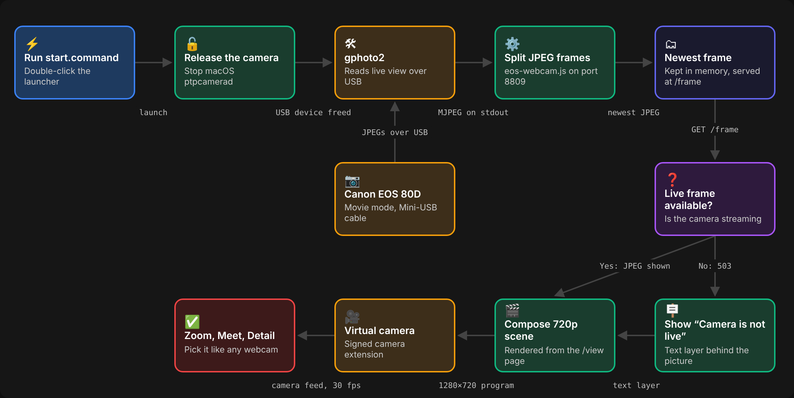

<p align="center">
  
</p>

<h1 align="center">EOS Webcam</h1>

<p align="center">
  Use a Canon EOS 80D as a Mac webcam over the normal USB cable, without Canon's app.<br>
  <a href="https://kotyzap.github.io/EOS-Webcam-via-USB-Mini/"><b>Explainer with interactive diagram</b></a>
</p>

---

Canon's EOS Webcam Utility freezes on macOS 26. This project replaces it with one small menu bar app and a free virtual camera, so the camera shows up in Zoom, Meet or Detail like any other webcam.

| | |
|---|---|
| Source picture | 960×640 at about 15 fps (the camera's USB live view) |
| Virtual camera | 1280×720 at 30 fps |
| CPU | about 1% on a Mac mini |
| Tested with | EOS 80D, Mac mini (Apple silicon), macOS 26.5 |

## Install

**Easiest: one line in Terminal.** Open Terminal, paste this and press Return:

```
curl -fsSL https://raw.githubusercontent.com/kotyzap/EOS-Webcam-via-USB-Mini/main/install.command | zsh
```

**Or with a file:** download `EOS-Webcam-Installer.zip` from the [latest release](https://github.com/kotyzap/EOS-Webcam-via-USB-Mini/releases/latest), unzip it and double-click `install.command`. macOS blocks a downloaded script the first time: open System Settings > Privacy & Security, scroll down and click **Open Anyway**.

Either way, a camera icon appears in the menu bar when it finishes. Then:

1. Connect the camera by USB, switch it on in movie mode and set **Auto power off** to **Disable**.
2. Click the camera icon in the menu bar and choose **Start camera**.
3. First time only: allow the virtual camera in System Settings > General > Login Items & Extensions > Camera Extensions. macOS lists it there as *Isocast Virtual Camera*.
4. Choose that same camera in your call app.

The installer puts **EOS Webcam.app** in Applications. After that you can delete the downloaded folder.

**Requirements:** Mac with Apple silicon, macOS 14 or later, [Homebrew](https://brew.sh), and a Canon camera that gphoto2 can read live view from.

## Using it

Everything is in the menu bar icon. The lens colour shows the state, and each menu item carries the colour it leads to.

| Menu item | Lens | What it does |
|---|---|---|
| Start camera | Green | Starts the camera stream and the virtual camera. |
| Stop camera | Orange | Frees the camera for other apps. Call apps show a "Camera is not live" card. |
| Turn off | Red | Ends the background script as well. The card stays. |

The menu also shows the camera's battery level (read when the stream starts) and opens a preview page at `http://127.0.0.1:8809`.

The menu and the preview page both have a live preview, Brightness, Contrast and Saturation sliders, a Mirror switch and Reset. They change the picture call apps get, stay in step with each other and are kept in `~/.eos-webcam.json`.

To start EOS Webcam with the Mac, add it under System Settings > General > Login Items.

## How it works



1. **gphoto2** reads the camera's live view over USB as a stream of JPEG frames.
2. **eos-webcam.js** splits that stream into frames and serves the newest one on `http://127.0.0.1:8809`.
3. **The virtual camera** renders the script's bare `/view` page at 720p and offers it to every app on the Mac.
4. When no frame arrives (camera stopped, off or unplugged), a **"Camera is not live"** card shows instead of a frozen picture.

macOS only lists a camera in call apps when a signed camera extension provides it, and writing your own needs a paid Apple Developer account. Borrowing an existing signed, open-source extension is what keeps this free (see [Built on](#built-on)).

## Troubleshooting

- **Orange lens after Start.** The camera is off, asleep, unplugged or held by another program. The preview page shows the reason, for example "No camera found". Close EOS Utility, Cascable and similar apps, then choose Start camera again.
- **The camera switches off mid-call.** Set Auto power off to Disable and use a dummy-battery AC adapter for long sessions.
- **The virtual camera is missing from the app's camera list.** Approve the extension in System Settings (step 3), then restart the call app.
- **To change the card text,** edit `src/setup.toml` and re-apply it (see `isocast apply --help`).

## Limits

- The picture is the camera's USB live view: 960×640 at about 15 fps, cropped to 16:9 and scaled to 720p. For full 1080p, use the camera's Mini-HDMI output with an HDMI capture dongle instead; that needs no software at all.
- The virtual camera engine is alpha software and cannot open a network stream directly yet, which is why the script serves the `/view` page for it.
- The installer has not been tested on a second Mac yet.

## Uninstall

Quit EOS Webcam from its menu and delete **EOS Webcam.app** from Applications. To remove the virtual camera too, run `/Applications/Isocast.app/Contents/MacOS/isocast vcam remove` and then delete **Isocast.app**.

## What's in the repo

| Path | Purpose |
|---|---|
| `install.command` | The installer. Builds the app from `src/` on your Mac, so macOS does not block it as a downloaded app. |
| `src/EOSWebcamMenu.swift` | The menu bar app. |
| `src/eos-webcam.js` | The Node script, no dependencies. Endpoints: `/` preview, `/view`, `/frame`, `/stream`, `/api/start`, `/api/stop`, `/api/status`, `/api/adjust` (for example `POST /api/adjust?contrast=120&mirror=1`). |
| `src/start.sh` | What Start camera runs. |
| `src/setup.toml` | Virtual camera scene: the `/view` page over the text card. |
| `docs/` | The explainer page served by GitHub Pages. |

## Built on

The virtual camera is provided by [Isocast](https://github.com/anomalyco/isocast) 0.0.10, an open-source recording app. The installer downloads it from its GitHub release, checks it against a known checksum and copies it to Applications. Its camera extension cannot be renamed, so macOS and call apps list the camera as *Isocast Virtual Camera*. The camera stream is read with [gphoto2](http://www.gphoto.org).

## Licence

MIT, see [`LICENSE`](LICENSE). Built by Pavel Kotyza &lt;kotyza@gmail.com&gt;, [4xs.dev](https://www.4xs.dev).

Not affiliated with Canon.
