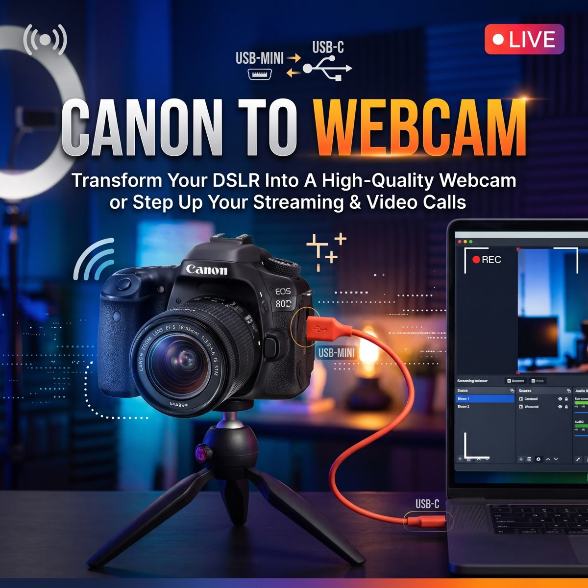
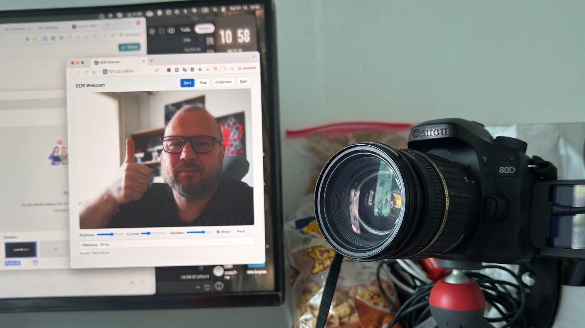
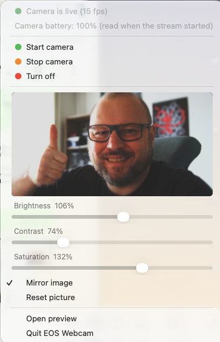

<p align="center">
  
</p>

<p align="center">
  
</p>

<h1 align="center">EOS Webcam</h1>

<p align="center">
  Use a Canon EOS camera (tested with the 80D) as a Mac webcam over the normal USB cable, without Canon's app.<br>
  <a href="https://kotyzap.github.io/EOS-Webcam-via-USB-Mini/"><b>Explainer with interactive diagram</b></a>
</p>

---



Canon's EOS Webcam Utility freezes on macOS 26. This project replaces it with one small menu bar app and a free virtual camera, so the camera shows up in Zoom, Meet or Detail like any other webcam.

| | |
|---|---|
| Source picture | 960×640 at about 15 fps (the camera's USB live view) |
| Virtual camera | 1280×720 at 30 fps |
| CPU | about 1% on a Mac mini |
| Tested with | EOS 80D, Mac mini (Apple silicon), macOS 26.5 |


## Supported cameras

Any camera that gphoto2 can read live view from over USB should work; only the **Canon EOS 80D** has been tested. These 265 models are listed with USB live view in the camera table of libgphoto2 2.5.34 (the version Homebrew installs). Sony: set the USB connection to PC Remote. Fujifilm: set the connection mode to USB tether shooting.

Check yours with the dropdown on the [explainer page](https://kotyzap.github.io/EOS-Webcam-via-USB-Mini/#compatibility), or run `gphoto2 --capture-movie=3s` with the camera connected: if it saves a short `movie.mjpg`, it works.

<details><summary><b>Canon</b> (138)</summary>

Digital IXUS 180, Digital IXUS 400, Digital IXUS 430, Digital IXUS 500, Digital IXUS II, Digital IXUS IIs, Digital IXUS v3, Digital PowerShot SX730HS, EOS 1D C, EOS 1D Mark IV, EOS 1D X, EOS 1D X MarkII, EOS 1D X MarkIII, EOS 5D Mark II, EOS 5D Mark III, EOS 5D Mark IV, EOS 5DS, EOS 5DS R, EOS 5Rm2, EOS 6D, EOS 6d Mark II, EOS 7D, EOS 7D MarkII, EOS 40D, EOS 50D, EOS 60D, EOS 70D, EOS 77D, EOS 80D, EOS 90D, EOS 100D, EOS 200D, EOS 250D, EOS 450D, EOS 500D, EOS 550D, EOS 600D, EOS 650D, EOS 700D, EOS 750D, EOS 760D, EOS 800D, EOS 850D, EOS 1000D, EOS 1100D, EOS 1200D, EOS 1300D, EOS 1500D, EOS 2000D, EOS 4000D, EOS Kiss X2, EOS Kiss X3, EOS M, EOS M2, EOS M3, EOS M5, EOS M6, EOS M6 Mark II, EOS M10, EOS M50, EOS M50m2, EOS M100, EOS M200, EOS R, EOS R1, EOS R3, EOS R5, EOS R5 C, EOS R6, EOS R6 Mark III, EOS R6m2, EOS R7, EOS R8, EOS R10, EOS R50, EOS R50 V, EOS R100, EOS Rebel T1i, EOS Rebel T6, EOS Rebel T7i, EOS Rebel T8i, EOS Rebel XSi, EOS RP, PowerShot A60 (PTP), PowerShot A70 (PTP), PowerShot A75, PowerShot A80 (PTP), PowerShot A85, PowerShot A95, PowerShot A300, PowerShot A310, PowerShot A400, PowerShot A460, PowerShot A510, PowerShot A520, PowerShot A620, PowerShot A640, PowerShot A650IS, PowerShot G3, PowerShot G3 X, PowerShot G5, PowerShot G5X, Powershot G6, PowerShot G7, PowerShot G7 X, PowerShot G7 X Mark II, PowerShot G7 X Mark III, PowerShot G9, PowerShot G9 X Mark II, PowerShot G10, PowerShot S1 IS, PowerShot S2 IS, PowerShot S3 IS, PowerShot S5 IS, PowerShot S50, Powershot S60, Powershot S70, PowerShot S80, PowerShot S230, PowerShot S400, PowerShot S410, PowerShot S500, PowerShot SD100, PowerShot SD110, PowerShot SD500, PowerShot SX70 HS, Powershot SX100 IS, PowerShot SX110 IS, PowerShot SX530 HS, PowerShot SX540 HS, PowerShot SX600 HS, PowerShot SX740 HS, Rebel T2i, Rebel T3, Rebel T3i, Rebel T4i, SX 620HS, SX 720HS

</details>
<details><summary><b>Nikon</b> (52)</summary>

Coolpix B700, Coolpix P1000, Coolpix P1100, Coolpix S9700, D3s, D3x, D4, D4s, D5, D6, D90, D300s, D500, D600, D610, D700, D750, D780, D800, D800E, D810, D810A, D850, D3200, D3300, D3400, D3500, D5000, D5100, D5200, D5300, D5500, D5600, D7000, D7100, D7200, D7500, Df, P950, Z5, Z6, Z6 III, Z6_2, Z7, Z7_2, Z8, Z9, Z30, Z50, Z50_2, Zf, Zfc

</details>
<details><summary><b>Sony</b> (42)</summary>

A6700 (PC Control), Alpha-A7 III (PC Control), Alpha-A7 IV (PC Control), Alpha-A7III (Control), Alpha-A7r II (Control), Alpha-A7r III (PC Control), Alpha-A7S (Control), Alpha-A7S II (Control), Alpha-A9 (Control), Alpha-A68 (Control), Alpha-A77 M2 (Control), Alpha-A99 M2 (Control), Alpha-A5100 (Control), Alpha-A6100 (PC Control), Alpha-A6300 (Control), Alpha-A6500 (Control), Alpha-A6600 (PC Control), Alpha-RX1R II (Control), Alpha-RX10M4 (Control), DSC RX0 II (PC Control), DSC-A7r IV (Control), DSC-A7S III (Control), DSC-QX30U, DSC-RX0 (PC Control), DSC-RX10M3 (Control), DSC-RX100M4, DSC-RX100M5A (PC Control), DSC-RX100M6 (PC Control), DSC-RX100M7 (PC Control), ILCE-1 (Control), ILCE-1M2 (PC Control), ILCE-7C (Control), ILCE-7M2 (Control), ILCE-7RM3A (PC Control), ILCE-7RM4A (PC Control), ILCE-7RM5 (PC Control), ILCE-9M3 (Control), ILCE-6400 (PC Control), ILME-FX3 (PC Control), ILX-LR1 (PC Control), ZV-1 (PC Control), ZV-E10 (Control)

</details>
<details><summary><b>Fuji</b> (20)</summary>

Fujifilm GFX100, Fujifilm GFX100 II, Fujifilm GFX 100S, Fujifilm GFX 100S (2nd), Fujifilm X100V, Fujifilm X-E3, Fujifilm X-H1, Fujifilm X-H2, Fujifilm X-M5, Fujifilm X-Pro2, Fujifilm X-Pro3, Fujifilm X-S10, Fujifilm X-T1, Fujifilm X-T2, Fujifilm X-T3, Fujifilm X-T4, Fujifilm X-T5, Fujifilm X-T30, GFX 50 R, GFX 50 S

</details>
<details><summary><b>Olympus</b> (6)</summary>

E-M1, E-M1 Mark II, E-M1 MII, E-M5 Mark II, OM-1, OM-1MarkII

</details>
<details><summary><b>Leica</b> (3)</summary>

Q3, SL3, SL (Typ 601)

</details>
<details><summary><b>Panasonic</b> (2)</summary>

DC-GH5, DMC-GX8

</details>
<details><summary><b>Sigma</b> (2)</summary>

fp, fp L

</details>
<!-- /cameras -->

## Install

**Easiest: one line in Terminal.** Open Terminal, paste this and press Return:

```
curl -fsSL https://raw.githubusercontent.com/kotyzap/EOS-Webcam-via-USB-Mini/main/install.command | zsh
```

**Or with a file:** download `EOS-Webcam-Installer.zip` from the [latest release](https://github.com/kotyzap/EOS-Webcam-via-USB-Mini/releases/latest), unzip it and double-click `install.command`. macOS blocks a downloaded script the first time: open System Settings > Privacy & Security, scroll down and click **Open Anyway**.

Either way, a camera icon appears in the menu bar when it finishes. Then:

1. Connect the camera by USB, switch it on in movie mode and set **Auto power off** to **Disable**.
2. Click the camera icon in the menu bar and choose **Start camera**.
3. First time only: allow the virtual camera in System Settings > General > Login Items & Extensions > Camera Extensions. macOS lists it there as *Isocast Virtual Camera*.
4. Choose that same camera in your call app.

The installer puts **EOS Webcam.app** in Applications. After that you can delete the downloaded folder.

**Requirements:** Mac with Apple silicon, macOS 14 or later, [Homebrew](https://brew.sh), and a Canon camera that gphoto2 can read live view from.

## Using it



Everything is in the menu bar icon. The lens colour shows the state, and each menu item carries the colour it leads to.

-  **Start camera** (green): starts the camera stream and the virtual camera.
-  **Stop camera** (orange): frees the camera for other apps. Call apps show a "Camera is not live" card.
-  **Turn off** (red): ends the background script as well. The card stays.

The menu also shows the camera's battery level (read when the stream starts) and opens a preview page at `http://127.0.0.1:8809`.

Below them, the menu has picture controls. The preview page has the same ones:

- **Live preview** of exactly what call apps get.
- **Brightness, Contrast, Saturation** sliders.
- **Mirror image**, for apps that show you flipped. Some apps, like Zoom, only flip your own view; this setting flips what everyone sees.
- **Reset picture** puts the sliders back to 100%.

The menu and the page stay in step, and the settings are kept in `~/.eos-webcam.json`.

The picture controls need a licence key: **5 EUR once** on [Ko-fi](https://ko-fi.com/s/bdcde4b564). The key arrives by email; choose **Unlock picture controls** in the menu (or use the preview page), paste it and click Save key. It is checked on your Mac, with no internet needed, and kept in `~/.eos-webcam-key`. Everything else is free.

<br clear="right">

To start EOS Webcam with the Mac, add it under System Settings > General > Login Items.

## How it works


1. **gphoto2** reads the camera's live view over USB as a stream of JPEG frames.
2. **eos-webcam.js** splits that stream into frames and serves the newest one on `http://127.0.0.1:8809`.
3. **The virtual camera** renders the script's bare `/view` page at 720p and offers it to every app on the Mac.
4. When no frame arrives (camera stopped, off or unplugged), a **"Camera is not live"** card shows instead of a frozen picture.

macOS only lists a camera in call apps when a signed camera extension provides it, and writing your own needs a paid Apple Developer account. Borrowing an existing signed, open-source extension is what keeps this free (see [Built on](#built-on)).

## Troubleshooting

- **Orange lens after Start.** The camera is off, asleep, unplugged or held by another program. The preview page shows the reason, for example "No camera found". Close EOS Utility, Cascable and similar apps, then choose Start camera again.
- **The camera switches off mid-call.** Set Auto power off to Disable and use a dummy-battery AC adapter for long sessions.
- **The virtual camera is missing from the app's camera list.** Approve the extension in System Settings (step 3), then restart the call app.
- **To change the card text,** edit `src/setup.toml` and re-apply it (see `isocast apply --help`).

## Limits

- The picture is the camera's USB live view: 960×640 at about 15 fps, cropped to 16:9 and scaled to 720p. For full 1080p, use the camera's Mini-HDMI output with an HDMI capture dongle instead; that needs no software at all.
- The virtual camera engine is alpha software and cannot open a network stream directly yet, which is why the script serves the `/view` page for it.
- The installer has not been tested on a second Mac yet.

## Uninstall

Quit EOS Webcam from its menu and delete **EOS Webcam.app** from Applications. To remove the virtual camera too, run `/Applications/Isocast.app/Contents/MacOS/isocast vcam remove` and then delete **Isocast.app**.

## What's in the repo

| Path | Purpose |
|---|---|
| `install.command` | The installer. Builds the app from `src/` on your Mac, so macOS does not block it as a downloaded app. |
| `src/EOSWebcamMenu.swift` | The menu bar app. |
| `src/eos-webcam.js` | The Node script, no dependencies. Endpoints: `/` preview, `/view`, `/frame`, `/stream`, `/api/start`, `/api/stop`, `/api/status`, `/api/adjust` (for example `POST /api/adjust?contrast=120&mirror=1`, needs a licence key), `/api/licence` (POST the key as the body). |
| `src/start.sh` | What Start camera runs. |
| `src/setup.toml` | Virtual camera scene: the `/view` page over the text card. |
| `docs/` | The explainer page served by GitHub Pages. |
| `web/` | eos.4xs.dev (Cloudflare Pages): the Ko-fi webhook that emails licence keys, and the thank-you page. |

## Built on

The virtual camera is provided by [Isocast](https://github.com/anomalyco/isocast) 0.0.10, an open-source recording app. The installer downloads it from its GitHub release, checks it against a known checksum and copies it to Applications. Its camera extension cannot be renamed, so macOS and call apps list the camera as *Isocast Virtual Camera*. The camera stream is read with [gphoto2](http://www.gphoto.org).

## Licence

MIT, see [`LICENSE`](LICENSE). Built by Pavel Kotyza &lt;kotyza@gmail.com&gt;, [4xs.dev](https://www.4xs.dev).

Not affiliated with Canon.
